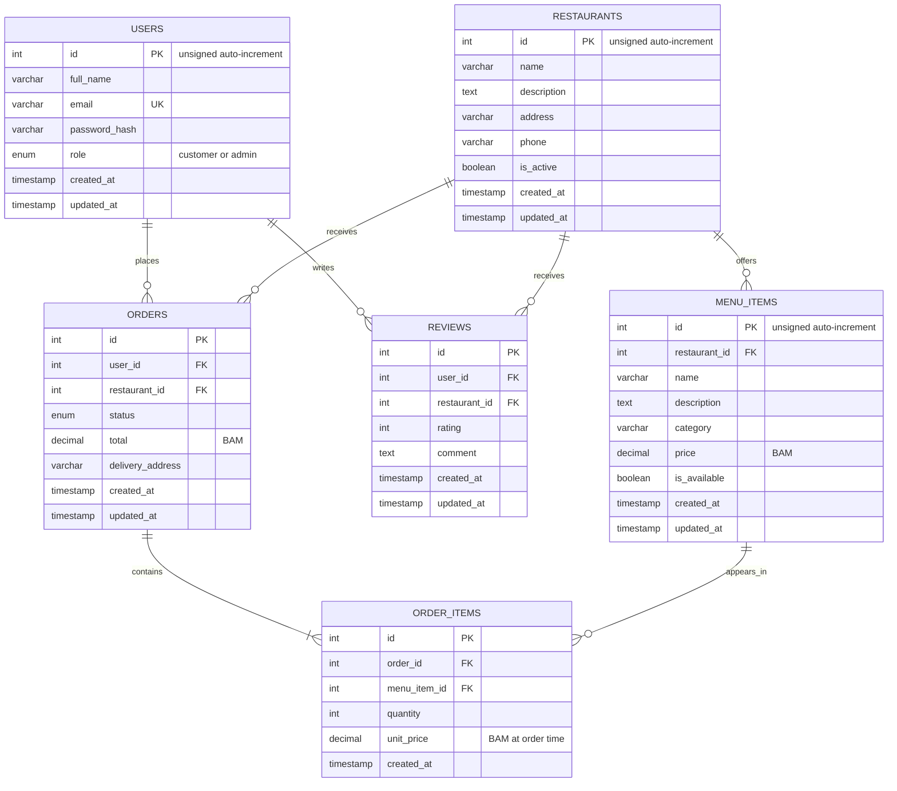

# EasyBites relational schema

**Milestone 2 schema.** `backend/database/easybites.sql` is the reproducible MySQL schema and sample-data export. It creates six relational entities and defines the keys and constraints shown below.

`ORDER_ITEMS` is the associative entity between orders and menu items. It stores the quantity and unit price at the time of purchase, so later menu-price changes do not rewrite the order history. One order belongs to one user and one restaurant. The database restricts deleting users/restaurants with orders and menu items referenced by order history; deleting a restaurant cascades to its menu items and reviews, and deleting an order cascades to its order items.

The schema enforces unique user emails, one review per user/restaurant, one line per menu item in an order, positive item quantities, non-negative prices/totals, and review ratings from 1 through 5. All tables use InnoDB and `utf8mb4`. Sample restaurant and menu-item rows are included; accounts, orders, and reviews are not seeded.
