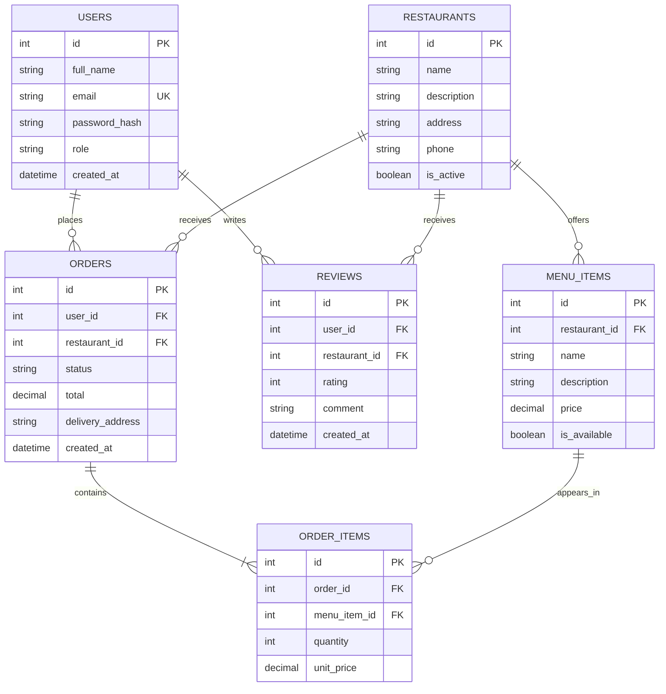

# EasyBites draft ERD

**Milestone 1 planning draft.** This diagram identifies the first six entities and their planned relationships. Column names and constraints may be refined during database implementation.

`ORDER_ITEMS` is the associative entity between orders and menu items. It stores the quantity and unit price at the time of purchase, so later menu-price changes do not rewrite the order history. The `role` field is planned to distinguish `customer` and `admin`; authorization rules will be implemented in the backend.
